# Skema Flowchart SDI Digital Library

Dokumen ini berisi contoh skema yang dapat digambar ulang di draw.io. Setiap contoh menggunakan format Mermaid agar hubungan antarproses mudah dibaca. Bentuk, warna, dan tata letak akhir bebas disesuaikan.

## Legenda Bentuk

| Bentuk          | Fungsi                       |
| --------------- | ---------------------------- |
| Oval            | Mulai atau selesai           |
| Persegi panjang | Proses                       |
| Belah ketupat   | Keputusan atau validasi      |
| Jajar genjang   | Input atau output            |
| Silinder        | Database                     |
| Dokumen         | Bukti transaksi atau laporan |

---

## 1. Arsitektur dan Aliran Data Utama

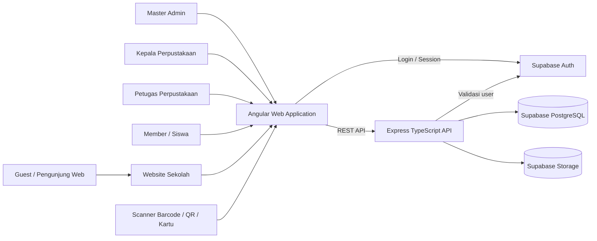

### Susunan draw.io

Letakkan pengguna di kiri, Angular di tengah kiri, Express di tengah, lalu Supabase Auth, Database, dan Storage di kanan. Website sekolah dan scanner dapat diletakkan di bagian atas atau bawah sebagai sumber akses tambahan.

---

## 2. Alur Login dan Pengarahan Role

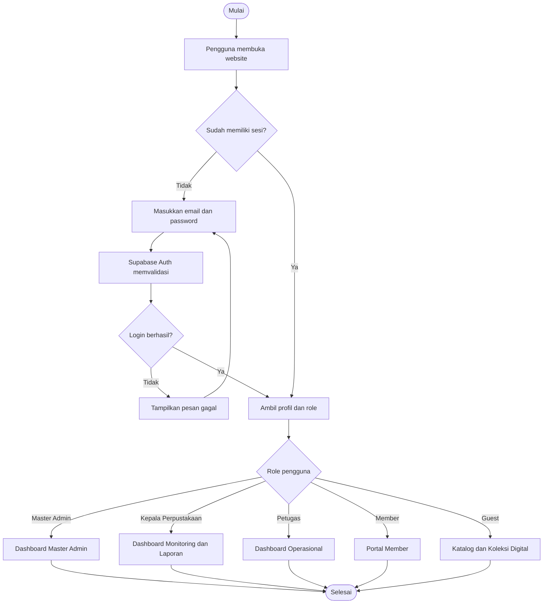

---

## 3. Alur Kunjungan Perpustakaan

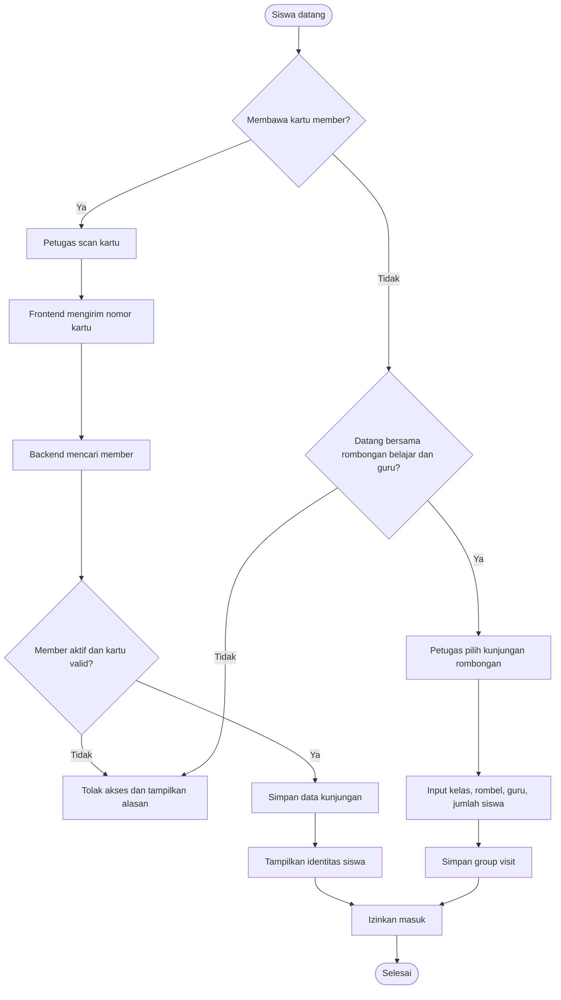

### Data yang dicatat

- Member atau rombongan belajar.
- Nomor kartu saat scan.
- Waktu masuk.
- Metode kunjungan.
- Petugas pencatat.
- Guru pendamping dan jumlah peserta untuk rombongan.

---

## 4. Alur Peminjaman Langsung oleh Petugas

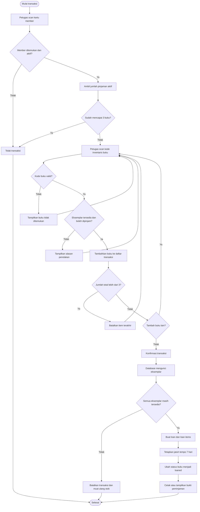

### Aturan yang ditempatkan pada decision

- Maksimal tiga buku aktif per member.
- Masa pinjam tujuh hari.
- Member harus aktif.
- Buku referensi khusus dapat ditolak.
- Satu eksemplar hanya boleh memiliki satu transaksi aktif.

---

## 5. Alur Reservasi Online Menjadi Peminjaman

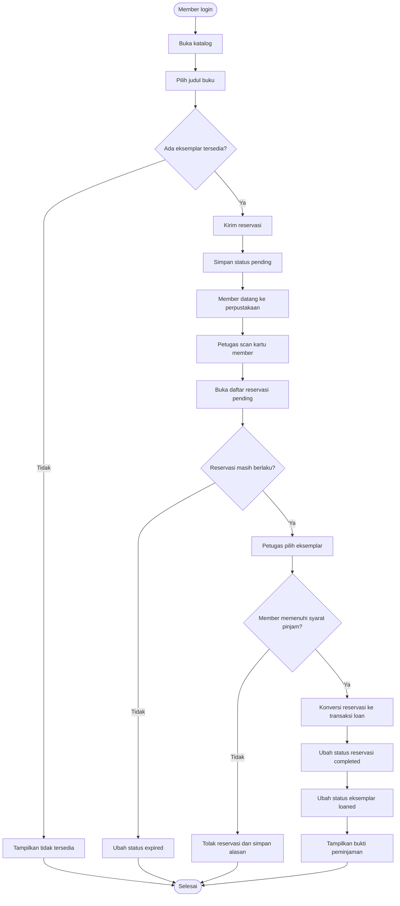

### Status reservasi

```text
pending → completed
pending → rejected
pending → cancelled
pending → expired
approved → completed
approved → cancelled
approved → expired
```

Untuk kebutuhan sekolah ini, approval dapat langsung disertai pembuatan transaksi peminjaman ketika siswa datang.

---

## 6. Alur Pengembalian, Keterlambatan, Rusak, dan Hilang

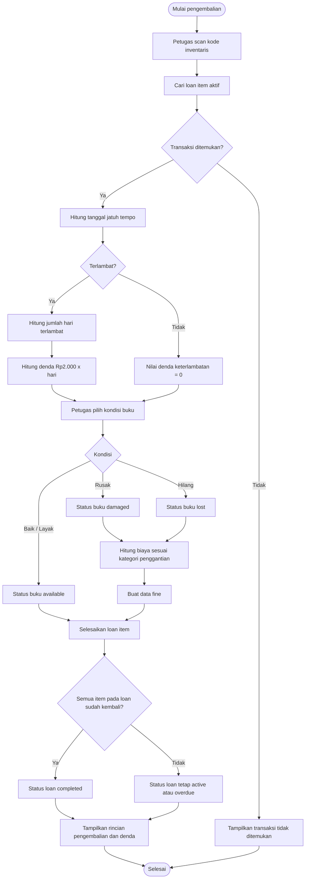

### Catatan denda

Denda keterlambatan dan biaya rusak/hilang dibuat sebagai data terpisah. Dengan demikian, satu buku dapat memiliki denda keterlambatan sekaligus biaya kerusakan.

---

## 7. Alur Pembayaran Denda

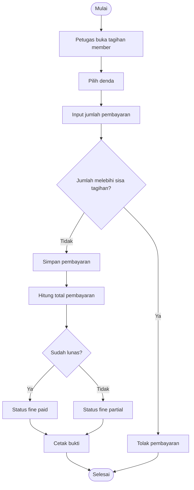

---

## 8. Alur Import Excel Siswa

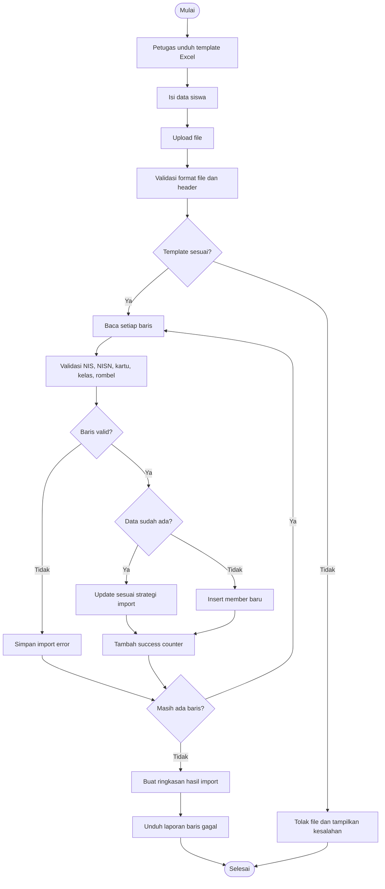

### Kolom template siswa

```text
nis
nisn
nama_lengkap
jenis_kelamin
kelas
rombongan_belajar
nomor_kartu_pelajar
nomor_kartu_perpustakaan
status_aktif
```

Kode kartu perpustakaan harus unik. Strategi update atau skip data lama harus dipilih secara eksplisit sebelum proses import dijalankan.

---

## 9. Alur Koleksi Digital

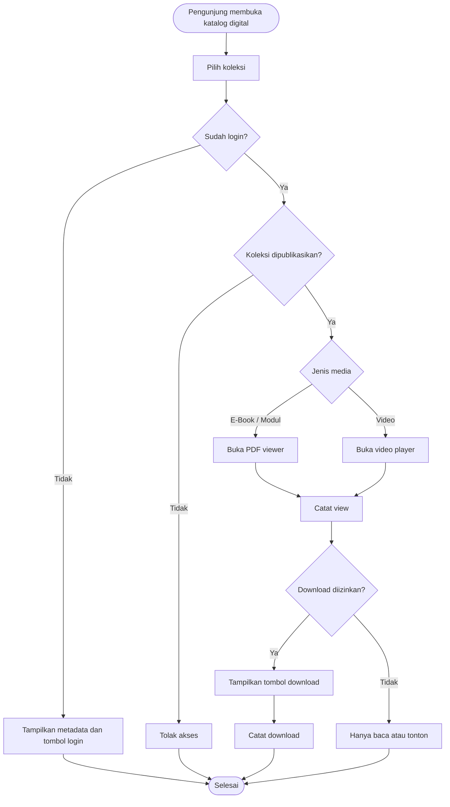

---

## 10. Alur Laporan

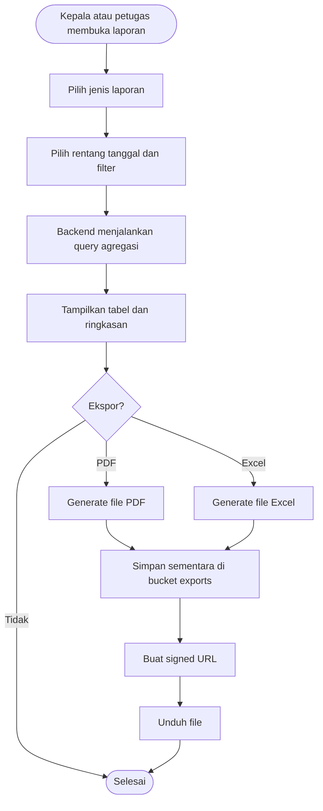

Jenis laporan utama:

- Buku paling sering dipinjam.
- Siswa paling aktif.
- Keterlambatan dan denda.
- Buku rusak atau hilang.
- Stok dan inventaris.
- Statistik kunjungan.
- Rekap koleksi digital.
- Data pendukung akreditasi perpustakaan.

---

## 11. Peta Status Eksemplar Buku

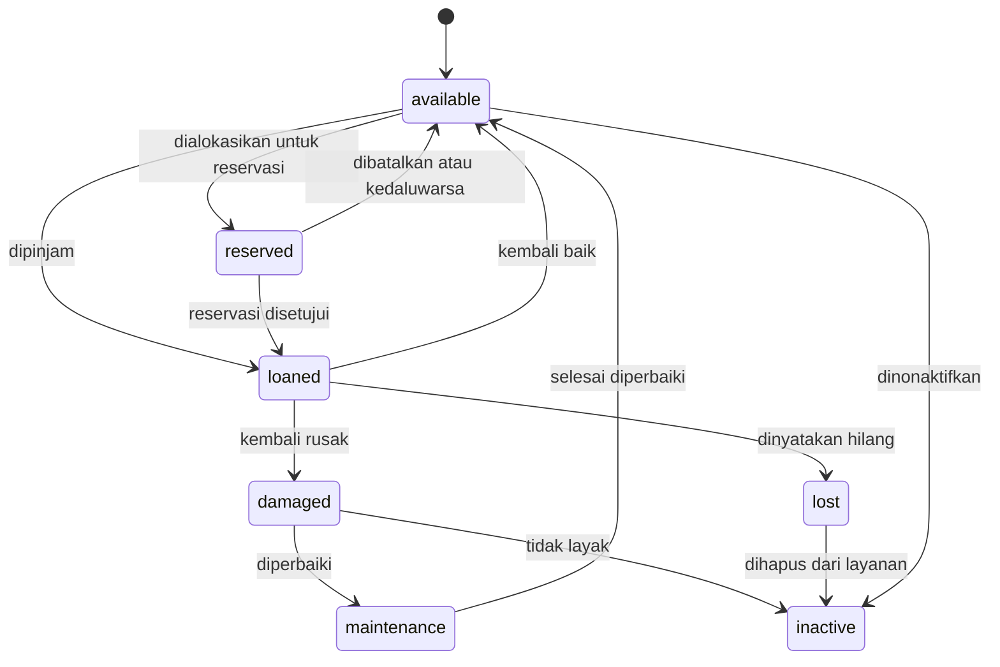

---

## 12. Urutan Gambar Flowchart yang Disarankan

Untuk dokumentasi proyek, cukup buat tujuh halaman draw.io:

1. Arsitektur dan aktor sistem.
2. Login dan pembagian role.
3. Kunjungan perpustakaan.
4. Peminjaman langsung.
5. Reservasi online.
6. Pengembalian dan denda.
7. Import Excel dan koleksi digital.

Alur pembayaran denda, laporan, dan status buku dapat dimasukkan sebagai subdiagram pada halaman yang paling relevan.
